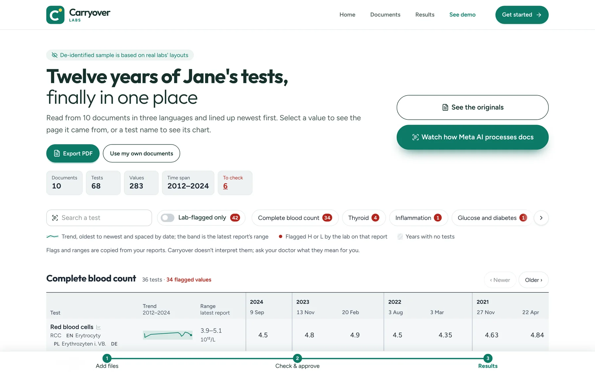
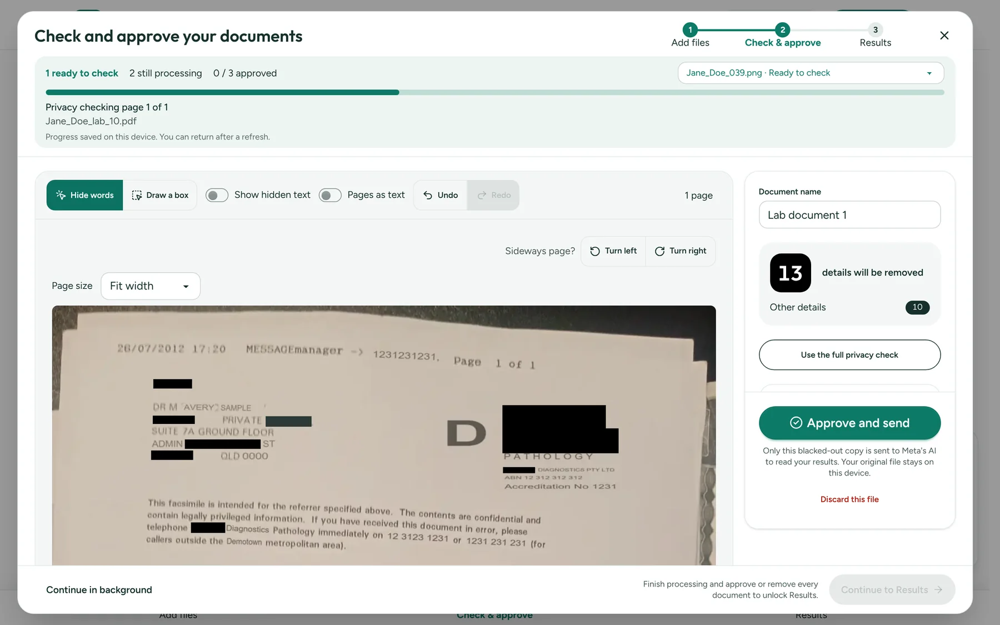
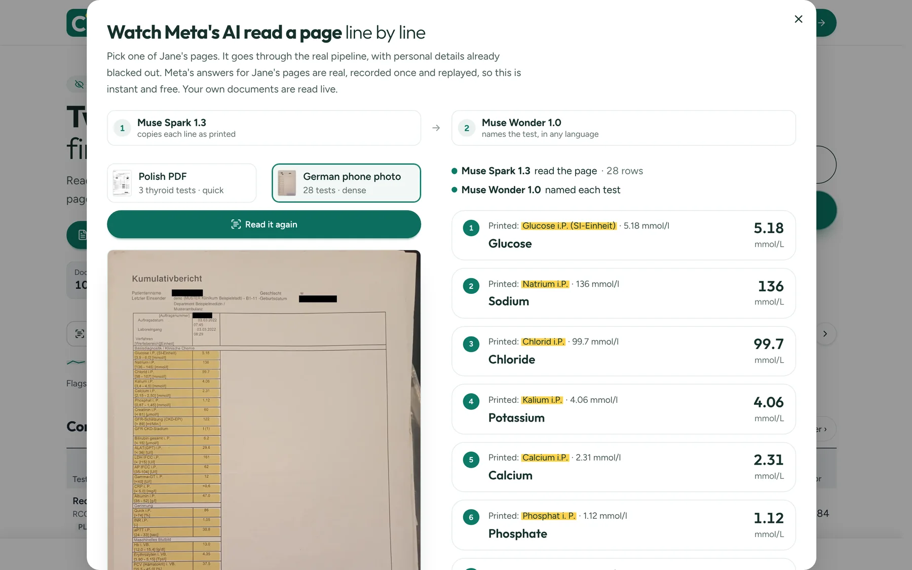
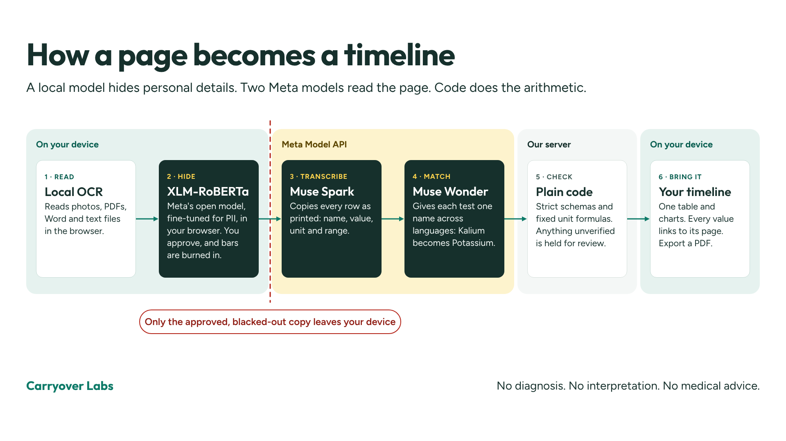
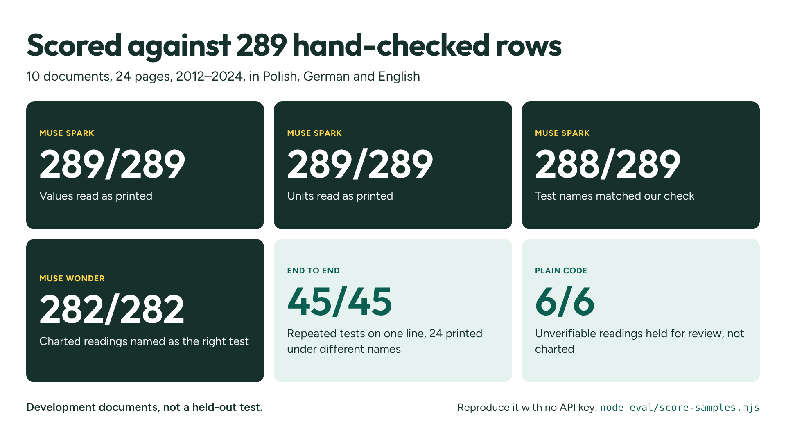

<div align="center">


# Carryover Labs

**Years of lab reports. One timeline for a short doctor's appointment.**

[](https://carryover.pl/demo)
[](#run-it)


[How it works](#how-it-works) · [Local PII redaction](#local-pii-redaction) · [How well it works](#how-well-it-works) · [Privacy](#privacy) · [Run it](#run-it) · [Built for the hackathon](#built-for-the-hackathon)

</div>



Carryover turns years of lab reports in Polish, German and English into one timeline a patient can bring to a short doctor's appointment. Personal details are found and blacked out in the browser by a local model built on Meta's XLM-RoBERTa, before anything is sent. Every chart point links back to the page it came from.

> [!IMPORTANT]
> Carryover does not diagnose, interpret results or give medical advice. High and low flags and reference ranges are copied from the reports.

## Why it exists

Lab results pile up as PDFs, phone photos and faxes, in different formats and languages. The same test can be printed as "Erytrocyty", "Erythrozyten i. VB." and "RCC", so a trend across years is hard to see in a short appointment. Carryover keeps those readings on one line, with the original page one tap away.

## Try it

Open **[carryover.pl/demo](https://carryover.pl/demo)**. It needs no account and shows a de-identified sample: 10 lab documents from 2012–2024 under the stand-in name Jane Doe, based on real reports and published with the owner's consent. They cover three languages: Polish PDFs from two labs, a German report and an English fax, both photographed. Every result row on them is shown, and the charts on `/demo` are prepared data.

- **See the originals** shows the pages the results came from. Every name, lab and address on them has been replaced.
- **Watch how Meta AI processes docs** sends one of two blacked-out sample pages through the pipeline and shows Meta's recorded answers line by line.
- **Try the sample patient**, on the Documents page, runs Jane's documents through the normal flow: the privacy check on your device, your approval, then reading and charting.

| Check every page before it leaves                                                         | Watch the models read it                                                                              |
| ----------------------------------------------------------------------------------------- | ----------------------------------------------------------------------------------------------------- |
|  |  |

> [!NOTE]
> **The sample patient's model responses are real, just cached.** Muse Spark's transcription of each of her 24 pages and Muse Wonder's identity of every test name on them were recorded once from the Meta Model API and are committed in [`api/samples/recorded.json`](api/samples/README.md). The server replays them through the same code as a live answer, so the sample costs nothing, needs no API key and keeps working when the day's spending limit is reached. The recordings were made from the sample pages as published, so hiding more on them doesn't change what comes back. Your own documents are always read live, and nothing about them is cached.

## How it works



1. **Add a file.** Photos, PDFs, Word and text files are read in the browser (Tesseract OCR, pdf.js, mammoth).
2. **Hide personal details.** A local model built on **XLM-RoBERTa** and rules suggest names, addresses and identifiers to hide. The person checks every page, turns sideways pages upright, hides more by tapping words or drawing boxes, and approves. Masks are burned into fresh page images.
3. **Read the results.** Each approved, redacted page image is queued as a job for **Muse Spark**, which transcribes the lab table literally. The browser collects results with a long poll, so slow model calls never hold a request open.
4. **Match tests across languages.** **Muse Wonder** maps the printed test names of the whole batch to one identity per test. Unit conversion and chart building are deterministic server code; the model never supplies numbers.
5. **Bring it to the appointment.** Print the results page or save it as a PDF from the print dialog.

Readings with an uncertain transcription, an unresolved identity, a missing date or an unverifiable unit stay out of the charts and are listed for review with a reason. The full design is in [architecture](docs/architecture.md).

## Local PII redaction

Health records are too sensitive to redact on a server, so Carryover does it in the browser. It runs [`bardsai/eu-pii-anonimization-multilang`](https://huggingface.co/bardsai/eu-pii-anonimization-multilang), a token classifier built on Meta AI's open [XLM-RoBERTa](https://huggingface.co/FacebookAI/xlm-roberta-base), with no call to any server to find personal details.

- **On your device:** the model runs in a Web Worker, as WebGPU FP16 (about 555 MB) or CPU Q8 (about 279 MB). It's downloaded once from Hugging Face at a pinned revision, then reused.
- **Model plus rules:** rules catch IDs, emails and postcodes alongside the model. Details hidden in one document are reused in the next.
- **You decide:** you check every page, hide more by tapping words or drawing boxes, and approve. Manual review skips the model entirely.
- **Burned in, not covered up:** masks are burned into a fresh JPEG, so nothing sits underneath. Reopening a saved copy can only add masks.

On a synthetic page with five identity fields, the last local check found and fully covered all five and masked no result. On rotated pages, automatic detection found nothing, because OCR doesn't detect orientation, so those pages are turned upright and hidden by hand. `node eval/check-pipeline-privacy.mjs` runs the check in a browser with WebGPU.

## How well it works



On the sample patient's 10 documents (24 pages, 2012–2024, three languages, two of them phone photos), Meta's recorded answers were scored against all 289 result rows checked by hand. Muse Spark read every value and unit as printed. Muse Wonder named every charted reading as the right test. All 45 tests that appear in more than one report stay on one line, including 24 printed under different names.

> [!CAUTION]
> These documents were used while building Carryover, so they show the pipeline works end to end, not how it does on layouts it has never seen.

`node eval/score-samples.mjs` reproduces the numbers with no key. The method and the caveats are in [evaluation](docs/evaluation.md).

## Privacy

| Data                                                                    | Where it goes                  |
| ----------------------------------------------------------------------- | ------------------------------ |
| Original files, filenames, OCR words, hidden text                       | Nowhere: browser only          |
| Approved, redacted page images                                          | Our API, then Muse Spark       |
| Printed test names, units, specimens, section headings and word results | Our API, then Muse Wonder      |
| Approved sample patient pages                                           | Our API only (recorded answer) |
| Charts, corrections, printed copy                                       | Browser only                   |

Results are stored in the browser, and "Delete all my data from this browser" in the footer removes them. The API holds a job only in memory, for at most 15 minutes. Anything a person leaves visible on an approved page is sent, so the review step matters.

Optional Google Analytics runs only on the home and demo pages, only after a visitor accepts it, and never on documents or results.

## Run it

### With Docker

```sh
docker compose up
```

Open http://localhost:3000 once the log says `App and API are running`. The first run takes a few minutes. There is one container and no separate frontend or port 4200: the image builds the app and the API for Linux and serves both from one origin.

Put `META_MODEL_API_KEY` in `api/.env` to read your own documents. Without it, `/demo`, the sample patient and on-device redaction still work. The port is bound to `127.0.0.1` because the API spends your Meta credits.

### Locally

Use Node 24 (npm 11; `.nvmrc` pins it, and older npm stops with a clear message).

```sh
npm ci
npm --prefix api ci
cp api/.env.example api/.env   # then set META_MODEL_API_KEY (and optionally MODEL_DAILY_BUDGET_USD)
npm run start:api
# in a second terminal
npm start
```

Open http://localhost:4200. Without a key, everything but reading your own documents works: `/demo`, the sample patient and on-device redaction.

## Built for the hackathon

Carryover was built for the [Meta Global AI Developer Hackathon](https://cerebralvalley.ai/e/meta-ai-developer-hackathon), in the **Build for Your World** track. The app, the API, the review and redaction flow, the Spark and Wonder prompts and schemas, the test catalogue, unit conversion and the evaluation were built during the event.

The repository starts on Oct 26. The Oct 29 commit is a large rough draft generated during the hackathon. I didn't commit early, and the later commits refine it.

| Not built here                                                                                                                            | Used for                                 |
| ----------------------------------------------------------------------------------------------------------------------------------------- | ---------------------------------------- |
| Muse Spark 1.3, Muse Wonder 1.0 (Meta Model API)                                                                                          | Transcribing pages and identifying tests |
| [`bardsai/eu-pii-anonimization-multilang`](https://huggingface.co/bardsai/eu-pii-anonimization-multilang), built on Meta AI's XLM-RoBERTa | Finding personal details, in the browser |
| Tesseract OCR, pdf.js, mammoth                                                                                                            | Reading files in the browser             |
| Angular, NestJS and other open-source libraries                                                                                           | The app and the API                      |

## For developers

<details>
<summary><b>Check the code</b></summary>

```sh
npm run lint            # ESLint for the app, API and scripts
npm run format:check    # Prettier (use `npm run format` to fix)
npm test -- --watch=false
npm --prefix api test
npm run build
npm --prefix api run build
npx playwright install chromium   # once
npm run e2e             # upload → review → approve, the sample patient and the demo, against the built app
node eval/score-samples.mjs   # Meta's recorded answers against the hand-checked rows (no key)
```

CI runs the same steps, and prints the evaluation table. Tests use synthetic data and stubbed model calls; they never make paid requests. When `api/samples/recorded.json` is present, the API tests also check that it charts every sample document without a model.

</details>

<details>
<summary><b>Project layout</b></summary>

| Path                                        | What it does                                                                              |
| ------------------------------------------- | ----------------------------------------------------------------------------------------- |
| `src/app/extraction`                        | Reads files and runs local OCR                                                            |
| `src/app/pii`                               | Finds personal details (local model worker + rules)                                       |
| `src/app/redaction`, `src/app/review`       | Burns masks into page images; the review screen                                           |
| `src/app/core/local-history.ts`             | Browser storage for approved documents and results                                        |
| `src/app/core/results.service.ts`           | Sends approved pages to the API and saves the answers                                     |
| `src/app/results`                           | Charts, source viewer, corrections, print layout                                          |
| `api/src/batches`, `api/src/jobs`           | Batch job endpoints, Spark pages, Wonder normalization, sample replay, queue, spend limit |
| `api/src/records`                           | Meta model client, unit arithmetic and chart building                                     |
| `api/src/shared`                            | Types and pure helpers used by both the app and the API (`@shared/*` in the app)          |
| `api/samples`, `scripts/record-samples.mjs` | The sample patient's recorded Meta answers, and the script that records them              |
| `e2e`                                       | Browser smoke tests on the built app (Playwright)                                         |
| `eval`                                      | Evaluation: recorded answers against checked rows, live model and privacy checks          |

</details>

<details>
<summary><b>Deploying</b></summary>

`npm --prefix api start` serves the built app and the API from one origin. Keep the model key on the server and use HTTPS. `ops/` has example nginx and systemd files. Browser storage is not encrypted by the app, so use fictional data for shared demos.

#### Heroku

The Docker image serves the app and the API from one origin, so one Heroku app runs both. Keep it to a single dyno: jobs and the daily spending total live in one process's memory.

```sh
heroku create --stack container --region eu
heroku config:set META_MODEL_API_KEY=... MODEL_DAILY_BUDGET_USD=5 MODEL_CONCURRENCY=4
heroku container:login
heroku container:push web
heroku container:release web
heroku ps:type web=basic   # Eco dynos sleep
```

Heroku's registry doesn't accept OCI images, so turn off "Use containerd for pulling and storing images" in Docker Desktop and set `BUILDX_NO_DEFAULT_ATTESTATIONS=1` before pushing.

Heroku restarts a dyno about once a day and on every release or config change, and each restart resets the spending total, so a day's spending can reach about twice the limit.

</details>

<details>
<summary><b>What a public deployment costs</b></summary>

Only new documents cost money: each page is one Muse Spark call, and each batch a few Muse Wonder calls. `MODEL_DAILY_BUDGET_USD` (default `10`) caps that spending per UTC day for all visitors together. Each call is priced from the token usage Meta reports, at the rates in `api/src/jobs/daily-spend.ts` (per million input / output tokens: Spark $1.25 / $4.25, Wonder $4 / $20; reasoning is billed as output; check them against your Meta billing). While calls run, their worst case is held back, so parallel calls can't overshoot by much. Once the limit is reached, new documents get a plain "try again tomorrow" message until midnight UTC; the sample patient and the demo keep working, because they never call Meta. There is no other rate limiting.

To re-record the sample patient after changing a prompt, a schema or a model: `npm --prefix api run build && node scripts/record-samples.mjs --refresh` (about $1–2), then commit `api/samples/recorded.json`.

</details>
