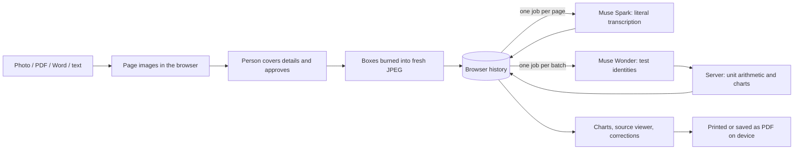

# Architecture

Carryover is an Angular app where the person covers personal details on each page, plus a small NestJS API that runs approved page images through Meta's models as jobs. Muse Spark and Muse Wonder are the only models the project runs, and neither sees a page before it's approved. The server writes nothing to disk; results wait in its memory until the browser confirms it saved them, for at most 15 minutes.

## Browser

| Area       | Files                                                      | Notes                                                                                                                                                                                                                                                                                                                                                                                                             |
| ---------- | ---------------------------------------------------------- | ----------------------------------------------------------------------------------------------------------------------------------------------------------------------------------------------------------------------------------------------------------------------------------------------------------------------------------------------------------------------------------------------------------------- |
| Opening    | `extraction/`                                              | Turns each file into page images in the browser (pdf.js, mammoth). No model or OCR runs here.                                                                                                                                                                                                                                                                                                                     |
| Redaction  | `redaction/`, `review/`                                    | The person drags boxes over personal details; a tap removes one. The review screen and the burned image share one mask geometry (`@shared/mask-geometry`); turning a page turns its boxes with it. Boxes are burned into a fresh JPEG. Reopening a saved copy can only add boxes.                                                                                                                                 |
| Queue      | `core/document-queue.service.ts`, `core/queue-recovery.ts` | Processes files one at a time; unfinished work survives a refresh (IndexedDB checkpoint).                                                                                                                                                                                                                                                                                                                         |
| Storage    | `core/local-history.ts`, `core/clear-local-data.ts`        | Approved documents, transcriptions and results in localStorage (parsed once and kept in memory until it changes); page images and the queue in IndexedDB. "Delete all my data from this browser" in the footer removes all of it.                                                                                                                                                                                 |
| Processing | `core/results.service.ts`, `core/job-client.ts`            | Submits each unsaved page as a job, collects results with one long poll, saves each page and confirms it, then queues normalization once every document is approved. A refresh resumes the same batch and sends failed pages again; a dropped connection is retried. A server that says no (switched off, today's limit) is reported at once; a queue that stays full for about two minutes stops with a message. |
| Results    | `results/`                                                 | Charts with keyboard access and data tables, a source viewer, corrections with history, and an A4 print layout for saving as PDF.                                                                                                                                                                                                                                                                                 |

## API

Page transcription and normalization run as **jobs**. A request returns `202 Accepted` at once; the browser collects results with one long poll per batch, so no request stays open for the 15–60 s a model call takes. Jobs live only in the API's memory. The `/demo` page's "Watch Meta's AI read a page" uses the same endpoints with a throwaway batch and one of two de-identified, blacked-out sample pages.

**Sample patient.** A page submitted with `sample: "<document>:<page>"` (one of Jane Doe's pages from `core/demo-documents.ts`) is never sent to Meta. The API answers it from `api/samples/recorded.json`: Muse Spark's real answer for that page, recorded once by `scripts/record-samples.mjs`, run through the same `processPage` code as a live answer. Normalization looks every question up in the recorded Muse Wonder identities first (keyed by folded printed name, percentage and fluid) and asks Wonder only for the rest, so a batch of sample documents needs no call at all. Sample pages take no model slot, skip the queue limits and the daily spending limit, and work without a key; a sample without a recording is refused (`400`), never read live. `GET /api/config` lists the recorded pages (`samplePages`); the app offers only documents with every page recorded, and hides the button when there are none.

| Request                                                | Purpose                                                                                                                                                                                                                                                                   |
| ------------------------------------------------------ | ------------------------------------------------------------------------------------------------------------------------------------------------------------------------------------------------------------------------------------------------------------------------- |
| `POST /api/batches/:batchId/pages`                     | Queue one approved PNG/JPEG page for `muse-spark-1.3`. The same page and revision again returns the existing job.                                                                                                                                                         |
| `POST /api/batches/:batchId/normalize`                 | Queue `muse-wonder-1.0` test identification: one question per printed name (case and spacing ignored; percentages and other body fluids separate), up to 40 per call and 400 per request. Each answer gives the test, its panel and English for results printed in words. |
| `GET /api/batches/:batchId?since=:version&wait=20`     | The batch's jobs and results. Answers on the next change, or after at most 20 s.                                                                                                                                                                                          |
| `DELETE /api/batches/:batchId/pages/:pageId?revision=` | Confirm a saved page, or cancel it (the Meta call is aborted).                                                                                                                                                                                                            |
| `DELETE /api/batches/:batchId`                         | Cancel and forget the whole batch.                                                                                                                                                                                                                                        |
| `GET /api/health`, `GET /api/config`                   | Availability; the model names, whether new documents can be read (`live`) and which sample patient pages have recorded answers (`samplePages`).                                                                                                                           |

The batch ID is a random UUID kept in the browser; it is never listed. A full queue answers `429` when a page is submitted, never halfway through; an unknown or expired batch reads as empty, and the browser sends its unsaved pages again. While a long poll is open, a newly approved page ends it early so the page is sent at once.

Every response carries a Content-Security-Policy (`api/src/security/http-security.ts`): scripts and workers only from this origin, WebAssembly for pdf.js's image decoders, network only to this origin, no framing. Every model answer must match a strict JSON schema (Ajv). Responses over 256 KiB, truncated answers and invalid dates or regions are rejected. Unit factors come only from `records/units.ts`. Readings with an uncertain transcription, an unresolved identity, a missing date or an unverifiable unit stay out of the charts and are listed for review with a reason. Provider error bodies are never logged or returned.

Limits (`api/src/jobs/`): `MODEL_CONCURRENCY` model calls at once (default 8, round-robin between batches); `MODEL_DAILY_BUDGET_USD` US dollars of Meta calls per UTC day across everyone (default 10), priced from the token usage each answer reports (cut-off answers included, and the worst case when a call fails without a report), with the worst case of running calls held back; once reached, new pages and normalizations that need Meta get `503` with a plain message until midnight UTC; 40 pages per batch; 400 distinct test names per normalization; 200 jobs and about 300 MB of waiting images in total; a page image is dropped from memory as soon as its job finishes, fails or is cancelled; 15 minutes without contact before a batch is purged; 240 s per model call. There are no per-client rate limits. A malformed request gets `400`. The queue and the spending total live in one process (a restart resets the day's total); several API processes would need a shared store.

## What leaves the device

| Data                                                                    | Where it goes                  |
| ----------------------------------------------------------------------- | ------------------------------ |
| Original files, filenames, anything you cover                           | Nowhere: browser only          |
| Approved, redacted page images                                          | Our API, then Muse Spark       |
| Printed test names, units, specimens, section headings and word results | Our API, then Muse Wonder      |
| Approved sample patient pages                                           | Our API only (recorded answer) |
| Charts, corrections, printed copy                                       | Browser only                   |

Anything a person leaves visible on an approved page is sent. While a job runs and until the browser confirms it saved the result (at most 15 minutes), the page image or its transcription is held in the API's memory, never on disk. Provider retention follows the Meta account's settings.
