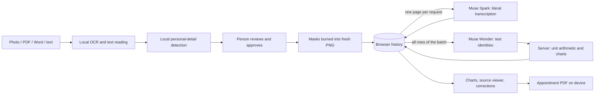

# Architecture

Carryover is an Angular app that does all reading and redaction in the browser, plus a small stateless NestJS API that forwards approved page images to Meta's models. Nothing is stored on the server.



## Browser

| Area          | Files                                                      | Notes                                                                                                                                                                                                                               |
| ------------- | ---------------------------------------------------------- | ----------------------------------------------------------------------------------------------------------------------------------------------------------------------------------------------------------------------------------- |
| Reading       | `extraction/`                                              | One OCR pass per page (Polish, German, English). No orientation detection: rotated photos need manual masking.                                                                                                                      |
| Privacy check | `pii/`                                                     | `bardsai/eu-pii-anonimization-multilang` in a Web Worker (WebGPU FP16 ≈ 555 MB, or CPU Q8 ≈ 279 MB) plus rules for IDs, emails and postcodes. Manual review skips the model. Details hidden in one document are reused in the next. |
| Redaction     | `redaction/`, `review/`                                    | The review screen and the burned image share one mask geometry (`@shared/mask-geometry`). Reopening a saved copy can only add masks.                                                                                                |
| Queue         | `core/document-queue.service.ts`, `core/queue-recovery.ts` | Processes files one at a time; unfinished work survives a refresh (IndexedDB checkpoint).                                                                                                                                           |
| Storage       | `core/local-history.ts`                                    | Approved documents, transcriptions and results in localStorage; page images in IndexedDB. Clearing site data removes everything.                                                                                                    |
| Processing    | `core/results.service.ts`                                  | Sends at most three pages at once, saves each answer immediately, and asks for normalization once every document is approved.                                                                                                       |
| Results       | `results/`, `appointment/`                                 | Charts with keyboard access and data tables, a source viewer, corrections with history, "Find missed readings", and PDF export in a worker.                                                                                         |

## API

| Endpoint                                  | Model             | Input                                                              | Output                                                                                     |
| ----------------------------------------- | ----------------- | ------------------------------------------------------------------ | ------------------------------------------------------------------------------------------ |
| `POST /api/demo/extract`                  | `muse-spark-1.3`  | One approved PNG/JPEG page, re-encoded without metadata            | Literal rows: name, value, unit, range, flag, dates, specimen, method, region, uncertainty |
| `POST /api/demo/records`                  | `muse-wonder-1.0` | Distinct name / unit / specimen / method combinations of the batch | One test identity per combination; the server then converts units and builds charts        |
| `GET /api/health`, `GET /api/demo/config` | —                 | —                                                                  | Availability and model name                                                                |

Every model answer must match a strict JSON schema (Ajv). Responses over 256 KiB, truncated answers and invalid dates or regions are rejected. Unit factors come only from `records/units.ts`. Readings with an uncertain transcription, an unresolved identity, a missing date or an unverifiable unit stay out of the charts and are listed for review with a reason. Provider error bodies are never logged.

Limits: four concurrent model requests per API process, a per-client request budget, 21 MB JSON bodies, 150 s per model call.

## What leaves the device

| Data                                              | Where it goes             |
| ------------------------------------------------- | ------------------------- |
| Original files, filenames, OCR words, hidden text | Nowhere: browser only     |
| Approved, redacted page images                    | Our API, then Muse Spark  |
| Printed test names, units, specimens and methods  | Our API, then Muse Wonder |
| Charts, corrections, questions, PDF               | Browser only              |

Anything a person leaves visible on an approved page is sent. Provider retention follows the Meta account's settings.

## GPU model preparation

The WebGPU export is generated, not committed:

```sh
python -m pip install onnx==1.23.2 onnxruntime==1.31.1
python scripts/prepare-gpu-model.py
```

It writes `public/models/pii-fp16-62ca5712-v1/`. Without it, the app uses the CPU export from Hugging Face.
