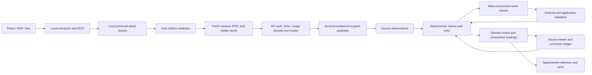

# Architecture

Local reading and redaction minimise uploaded content. Deterministic parsing and unit arithmetic preserve source readings. Meta models help with unfamiliar names and matching; their output is checked and remains reviewable.

The personal-detail browser model is a third-party multilingual NER model; it is not the Meta integration. Muse Spark runs in the server's reduced-data workflow. Hidden words and page images are not included in model prompts.

The frontend uses Angular signals with lazy-loaded pages. Source documents are prepared one at a time with a bounded queue. Redaction and saved source state are separate, so reopening a document can add masking but cannot reveal deleted text. Originals remain in tab memory until discarded; reload is not a local backup.

The API separates document storage, raw extraction, correction overlays, unit/name matching and model communication. The same observation carries source IDs into charts and the appointment packet. Cache versions invalidate extractor changes; source hashes invalidate reviews/corrections; per-account generation markers invalidate learned suggestions after deletion or redaction.

Storage encryption uses an externally supplied key. Development may run without it; production refuses to do so. Existing plaintext needs explicit migration. Process-local locks, request budgets and background jobs currently require one API process per storage directory.

Contracts are mirrored in frontend/backend TypeScript files. Keep changes aligned; shared runtime validation protects upload and model boundaries. CI runs synthetic regressions and builds. Physical-device usability, real-layout OCR evaluation and operational hosting review remain separate release gates.
