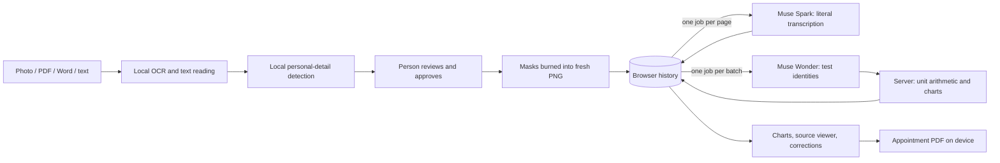

# Architecture

Carryover is an Angular app that does all reading and redaction in the browser, plus a small NestJS API that runs approved page images through Meta's models as jobs. The server writes nothing to disk; results wait in its memory until the browser confirms it saved them, for at most 15 minutes.



## Browser

| Area          | Files                                                      | Notes                                                                                                                                                                                                                                   |
| ------------- | ---------------------------------------------------------- | --------------------------------------------------------------------------------------------------------------------------------------------------------------------------------------------------------------------------------------- |
| Reading       | `extraction/`                                              | One OCR pass per page (Polish, German, English). No orientation detection: rotated photos need manual masking.                                                                                                                          |
| Privacy check | `pii/`                                                     | `bardsai/eu-pii-anonimization-multilang` in a Web Worker (WebGPU FP16 ≈ 555 MB, or CPU Q8 ≈ 279 MB) plus rules for IDs, emails and postcodes. Manual review skips the model. Details hidden in one document are reused in the next.     |
| Redaction     | `redaction/`, `review/`                                    | The review screen and the burned image share one mask geometry (`@shared/mask-geometry`). Reopening a saved copy can only add masks.                                                                                                    |
| Queue         | `core/document-queue.service.ts`, `core/queue-recovery.ts` | Processes files one at a time; unfinished work survives a refresh (IndexedDB checkpoint).                                                                                                                                               |
| Storage       | `core/local-history.ts`                                    | Approved documents, transcriptions and results in localStorage; page images in IndexedDB. Clearing site data removes everything.                                                                                                        |
| Processing    | `core/results.service.ts`, `core/job-client.ts`            | Submits each unsaved page as a job, collects results with one long poll, saves each page and confirms it, then queues normalization once every document is approved. A refresh resumes the same batch; a dropped connection is retried. |
| Results       | `results/`, `appointment/`                                 | Charts with keyboard access and data tables, a source viewer, corrections with history, and PDF export in a worker.                                                                                                                     |

## API

Page transcription and normalization run as **jobs**. A request returns `202 Accepted` at once; the browser collects results with one long poll per batch, so no request stays open for the 15–60 s a model call takes. Jobs live only in the API's memory.

| Request                                                     | Purpose                                                                                                                                                                                                                                               |
| ----------------------------------------------------------- | ----------------------------------------------------------------------------------------------------------------------------------------------------------------------------------------------------------------------------------------------------- |
| `POST /api/demo/batches/:batchId/pages`                     | Queue one approved PNG/JPEG page for `muse-spark-1.3`. The same page and revision again returns the existing job.                                                                                                                                     |
| `POST /api/demo/batches/:batchId/normalize`                 | Queue `muse-wonder-1.0` test identification: one question per printed name (case and spacing ignored; percentages and other body fluids separate), up to 40 per call. Each answer gives the test, its panel and English for results printed in words. |
| `GET /api/demo/batches/:batchId?since=:version&wait=25`     | The batch's jobs and results. Answers on the next change, or after at most 25 s.                                                                                                                                                                      |
| `DELETE /api/demo/batches/:batchId/pages/:pageId?revision=` | Confirm a saved page, or cancel it (the Meta call is aborted).                                                                                                                                                                                        |
| `DELETE /api/demo/batches/:batchId`                         | Cancel and forget the whole batch.                                                                                                                                                                                                                    |
| `GET /api/health`, `GET /api/demo/config`                   | Availability and model name.                                                                                                                                                                                                                          |

The batch ID is a random UUID kept in the browser; it is never listed. A full queue answers `429` when a page is submitted, never halfway through; an unknown or expired batch reads as empty, and the browser sends its unsaved pages again. While a long poll is open, a newly approved page ends it early so the page is sent at once.

Every model answer must match a strict JSON schema (Ajv). Responses over 256 KiB, truncated answers and invalid dates or regions are rejected. Unit factors come only from `records/units.ts`. Readings with an uncertain transcription, an unresolved identity, a missing date or an unverifiable unit stay out of the charts and are listed for review with a reason. Provider error bodies are never logged or returned.

Limits (`api/src/jobs/job-queue.ts`): `MODEL_CONCURRENCY` model calls at once (default 8, round-robin between batches), 40 pages per batch, 200 jobs and about 300 MB of waiting images in total, 15 minutes without contact before a batch is purged, 150 s per model call. The queue lives in one process; several API processes would need a shared store.

## What leaves the device

| Data                                              | Where it goes             |
| ------------------------------------------------- | ------------------------- |
| Original files, filenames, OCR words, hidden text | Nowhere: browser only     |
| Approved, redacted page images                    | Our API, then Muse Spark  |
| Printed test names, units, specimens and methods  | Our API, then Muse Wonder |
| Charts, corrections, questions, PDF               | Browser only              |

Anything a person leaves visible on an approved page is sent. While a job runs and until the browser confirms it saved the result (at most 15 minutes), the page image or its transcription is held in the API's memory, never on disk. Provider retention follows the Meta account's settings.

## GPU model preparation

The WebGPU export is generated, not committed:

```sh
python -m pip install onnx==1.23.2 onnxruntime==1.31.1
python scripts/prepare-gpu-model.py
```

It writes `public/models/pii-fp16-62ca5712-v1/`. Without it, the app uses the CPU export from Hugging Face.
